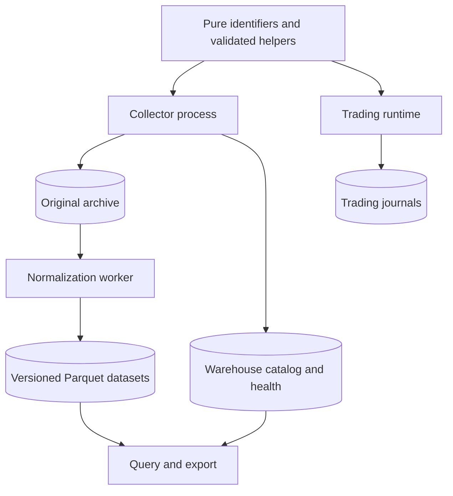
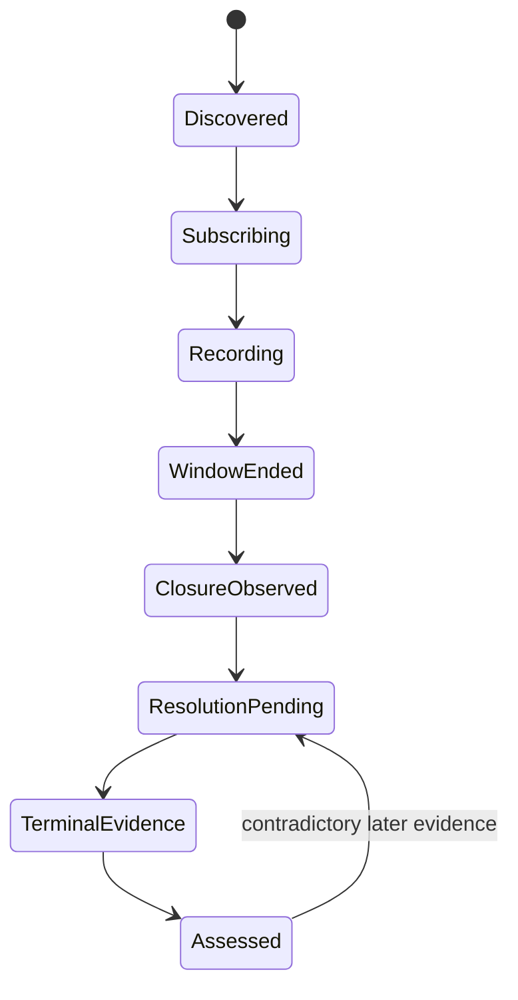

# Live Market Data Warehouse: Complete BTC 5-Minute Recording and Extensible Research Data

Status: implementation plan; the collector described here is not implemented.

Prepared: 2026-09-27. Repository reference: `1d3a575`, plus the working tree inspected on that date. Other trading-runtime work was already in progress. Recheck integration points before implementation; do not overwrite concurrent changes.

Developer reading order: read sections 1–4 for scope and integration, section 5 for the field contracts, sections 6–9 for operational behavior, and sections 10–12 for implementation and acceptance. Start at W0; do not begin by wiring the existing trading recorder into a storage sink. Provider facts below are cited separately from proposed engineering defaults. This plan has been reviewed against current documentation; live protocol verification remains an implementation gate.

## 1. Objective and delivery contract

Build an independently running, read-only live data collector. A developer or operator selects a collection profile, starts one command, and obtains durable original recordings, typed research datasets, and explicit coverage evidence. Start with BTC Up/Down five-minute markets. Make market-family and external-source extensions possible without changing the storage engine.

The intended entry point is:

```text
run_data_collection_live --profile btc-5m --root var/warehouse
```

All commands, modules, configurations, schemas, and tests below are planned interfaces unless explicitly described as existing. This document authorizes a design and implementation sequence, not a claim of production readiness.

The first release must allow a user to select a recorded BTC window and:

1. Retrieve its identifiers, both outcome tokens, rules, and trading conditions as observed over time.
2. Read the original messages supporting every normalized observation.
3. Reconstruct the observable books within valid recording intervals.
4. Join external observations using their actual availability times.
5. Inspect reference-boundary candidates separately from settlement evidence.
6. Identify late starts, interruptions, unknown continuity, missing values, and unresolved settlement.
7. Rebuild the same logical normalized dataset from the same raw inputs and software versions.

### 1.1 Scope

Required in this release:

- Continuous discovery and rollover for BTC five-minute markets, including both outcome tokens.
- Original Gamma and CLOB metadata responses; all received selected-market public stream messages, including unknown types.
- Published L2 snapshots/updates, public trade prints, quotes, tick changes, and lifecycle notifications.
- The reference feed required by the observed market rules, with authenticated PolyBolt support.
- Binance BTCUSDT individual trades and a declared depth feed; the default rich profile uses diff depth with bounded REST bootstrap.
- Continuous external streams across market boundaries.
- Durable scheduling of post-window resolution reads.
- Restart recovery, data-quality accounting, deterministic normalization, query/export support, and operating documentation.
- Extension contracts and offline proof for an additional family and a non-price external observation.

Out of scope:

- Historical archive downloads or attempts to fill lost live history.
- Strategy execution, order entry/cancellation, account inspection, redemption, or wallet mutations.
- A fill simulator, parameter optimizer, feature library, model training, or a profitable-strategy claim.
- Capturing all of Polymarket, private order-level information, all blockchain transactions, or arbitrary external information by default.
- Production collectors for every future family; implement BTC first and prove the extension seams with fixtures.

Live REST bootstrap, periodic metadata reads, and settlement follow-up are in scope. They read current state; they do not turn an unobserved past interval into a complete recording.

### 1.2 Meaning of completeness

Completeness is evaluated against an immutable profile version and an explicit time scope. It is never equivalent to “all information that exists.” Preserve every delivered selected-feed message, record declared depth/cadence limits, and report uncertainty in provider delivery.

Keep four dimensions separate:

1. **Capture integrity:** what reached the process and became durable.
2. **Reconstruction usability:** where books/references can be interpreted reliably.
3. **Semantic readiness:** whether identities, units, rules, and boundary meanings are validated.
4. **Settlement readiness:** pending, reported, or confirmed under a named policy.

An interval can have intact raw capture but unusable normalization. An otherwise healthy market can still have pending settlement. These must not collapse into one percentage or boolean.

## 2. Documentation review and source contracts

The following official sources were reviewed on 2026-09-27. These are documentation findings, not live endpoint attestations. Milestone W0 must save representative sanitized responses and resolve the specific ambiguities listed in section 2.3.

### 2.1 Provider surfaces

**S1 — Discovery.** Use Gamma event/market discovery, retaining series and relationship metadata. Keyset pagination is available. Traverse all returned relevant markets; do not take only the first market in an event. Source: [Discover Markets](https://docs.polymarket.com/market-data/discover-markets) and [List events with keyset pagination](https://docs.polymarket.com/api-reference/events/list-events-keyset-pagination).

**S2 — Public market WebSocket.** The documented wire endpoint is `wss://ws-subscriptions-clob.polymarket.com/ws/market`. Subscribe using outcome token IDs. Enable `custom_feature_enabled` to receive the additional quote/lifecycle event types. Capture `book`, `price_change`, `last_trade_price`, `tick_size_change`, `best_bid_ask`, `new_market`, and `market_resolved`, along with unknown payloads. The market channel documents an application `PING` every 10 seconds. Source: [Market Channel](https://docs.polymarket.com/api-reference/wss/market).

**S3 — Reference feeds.** PolyBolt uses `wss://ws-live-v2.polymarket.com/ws`. The `price.crypto.twap` channel with `symbol=btcusd` and `window_seconds=60` identifies Chainlink TWAP. Authentication uses existing CLOB API credentials. Sequences are scoped to connection and channel; snapshots and drop counters have separate meanings. Source: [PolyBolt overview](https://docs.polymarket.com/api-reference/live-data/overview).

**S4 — Migration semantics.** The RTDS migration distinguishes Chainlink TWAP from the Pyth spot-price channel. Do not substitute a similarly named BTC feed or reuse legacy fixed-point conversion for a decimal-string payload. Source: [RTDS to PolyBolt migration](https://docs.polymarket.com/migrate/rtds-to-polybolt).

**S5 — Current books.** `GET https://clob.polymarket.com/book?token_id=...` returns a current aggregated book and constraints. Preserve each response before conversion. Source: [Get order book](https://docs.polymarket.com/api-reference/market-data/get-order-book).

For scheduled audits, use the read-only `POST https://clob.polymarket.com/books` endpoint, with a JSON array of `{token_id: ...}` objects, in batches of at most 500 tokens. Archive the request token list and complete response so missing results are distinguishable from empty books. Sources: [Batch order-book reads](https://docs.polymarket.com/market-data/prices-order-books) and [Get order books request body](https://docs.polymarket.com/api-reference/market-data/get-order-books-request-body).

**S6 — Trading metadata.** `GET https://clob.polymarket.com/clob-markets/{condition_id}` exposes CLOB parameters including token mappings, tick, size, and fee details. Preserve the original field names and typed interpretations with provenance. Source: [Get CLOB market info](https://docs.polymarket.com/api-reference/markets/get-clob-market-info). Gamma also exposes richer market descriptions and fee/reward configuration: [Market Details](https://docs.polymarket.com/market-data/market-details).

**S7 — Resolution.** `GET https://data-api.polymarket.com/v2/resolutions` takes one selector family, such as `condition`. It returns condition-level state, payout/lifecycle evidence, and potentially transaction/block references. An empty result is not a losing outcome. Source: [Get resolution state](https://docs.polymarket.com/api-reference/markets/get-resolution-state).

**S8 — Capacity.** Provider request limits are shared by IP and may produce queueing as well as explicit errors. Apply collector-specific budgets below provider ceilings, accounting for the independently running trader. Source: [Rate Limits](https://docs.polymarket.com/api-reference/rate-limits).

**S9 — Semantics.** Events group binary markets, and outcome tokens carry the books. Store group relationships explicitly, including negative-risk flags; membership in an event is not proof of mutual exclusivity. Source: [Markets and Events](https://docs.polymarket.com/concepts/markets-events). Resolution is a lifecycle rather than merely reaching a scheduled end time: [Resolution](https://docs.polymarket.com/concepts/resolution).

**S10 — Binance.** Use the individual trade stream for individual-trade observations. For diff depth, buffer updates, bootstrap from REST, bridge the update-ID ranges, then enforce continuity. The REST snapshot is bounded to 5,000 levels per side; unchanged levels beyond its scope remain unknown. Source: [Official Binance stream specification](https://github.com/binance/binance-spot-api-docs/blob/master/web-socket-streams.md).

### 2.2 Transport choices for this implementation

- Implement dedicated recording transports under `data_warehouse/connectors/`, using raw WebSocket application messages and raw HTTP response bodies. This preserves fields that trading normalization deliberately discards.
- Use `websockets` for streams and an optional warehouse HTTP dependency (`httpx`) for async HTTP. Pin tested versions in the warehouse dependency constraints produced by W0/W1.
- Keep the trading package's current `polymarket-client==0.5.0` pin unchanged. A warehouse transport must not require upgrading the trading SDK to obtain a new feed.
- Read-only REST calls use an explicit method/path allowlist, including the read-only `POST /books`; HTTP verb alone does not determine whether an endpoint is permitted. The live collector has no order gateway, private signing key, or transaction submission facility.
- PolyBolt receives already provisioned API credentials from environment variables. Credential provisioning is a separate operator task. Do not derive keys or issue account mutations on collector startup.
- Preserve incoming market data exactly at the application-message/body boundary. Network packets and authentication frames are outside the raw-data contract.

### 2.3 W0 verification gates

Resolve these with official contracts and sanitized live examples before marking the corresponding adapter supported:

1. **Current BTC rules and boundary meaning:** identify the exact reference source, any TWAP interval, opening threshold semantics, closing comparison, and equality rule for actual selected windows. Never infer them from `btc-5m` alone.
2. **Opening threshold availability:** determine whether a documented structured response supplies the official threshold. If not, preserve reference candidates and mark official attestation unavailable. A first tick after the boundary is not automatically the official price to beat. Do not make page scraping a hidden required dependency.
3. **Book ordering:** explanatory and reference pages have differing ordering descriptions. Normalize by numeric price, never assume array position gives best price.
4. **Minimum size units:** retain the source value and source field; resolve its unit per endpoint contract. Store `UNKNOWN` if evidence conflicts; do not invent shares or collateral units.
5. **CLOB continuity:** verify which sequence/cursor fields actually exist. Do not apply Binance-style sequence logic to CLOB without such a contract. Hashes and timestamps alone do not establish total order or prove no lost updates.
6. **Resolution mapping:** document terminal status values and payout indexing from the resolution API. An illustrative API sample is not an enum specification. Unknown statuses remain unknown.
7. **Subscription behavior:** prove initial snapshot delivery, dynamic subscription behavior, reconnect semantics, extra-event flag, and heartbeat behavior for the selected wire protocol.
8. **Reference precision:** prefer the documented exact decimal representation; preserve original values and precision. Confirm subscription-history rows remain distinguishable from newly delivered live ticks.

Save the evidence, decisions, request examples, timestamp units, and field paths in `provider_contract_report.md` alongside this plan during implementation. Unsupported semantics may not be waved through as complete; raw recording may proceed in explicitly degraded mode after configuration is valid.

## 3. Existing project: reuse and separation

Review these files before coding:

- `src/tyrex_pm/core/ingress.py`: timing/provenance concepts are useful; `AppendOnlyIngressLog` is process-local, not a warehouse.
- `src/tyrex_pm/domain/polymarket/outcome_map.py`: reuse label-validated identity mapping where its pure contract fits.
- `src/tyrex_pm/adapters/polymarket/btc_5m_window.py`: useful window parsing; distinguish listing time from window time.
- `src/tyrex_pm/adapters/polymarket/sdk_public.py`: trading conversion supports a subset of messages and synthesizes some missing timestamps. Do not use it as the raw or canonical research path.
- `src/tyrex_pm/market_data/book_feed.py` and `book_store.py`: reference synchronization behavior and tests; the recorder needs its own persisted evidence and reconstruction validity.
- `src/tyrex_pm/adapters/polymarket/rtds_adapter.py`: legacy reference transport; do not assume it provides today's required feed.
- `src/tyrex_pm/adapters/binance/normalize.py`: trading conversion does not retain the full trade payload.
- `src/tyrex_pm/adapters/binance/depth_adapter.py`: top-20 snapshots at 100 ms, not a diff-depth collector.
- `src/tyrex_pm/runtime/market_family.py`: currently assumes periodic windows. Do not force sports or event-driven warehouse families into that runtime registry.
- `src/tyrex_pm/adapters/polymarket/ctf_payout.py`: potentially reusable pure encoding/decoding for optional later chain corroboration; it is not required to start live recording.
- `src/tyrex_pm/lab/evaluate_replay.py`: future export target; a fixture evaluator rather than a historical execution simulator.
- `old/Docs/DATA_LAKE.md`, `old/research/normalize/`, and `old/src/tyrex_pm/runtime/record_run.py`: design/test references only. Do not import or install the archived package.

### 3.1 Dependency boundary



- Same repository, separate command/process, root directory, configuration, and network connections.
- Neither trading imports warehouse modules nor warehouse imports `execution/`, `runtime/trading_runtime.py`, strategy drivers, or execution journals.
- Pure reuse is allowed only after checking transitive imports. Add an import-boundary test.
- `InputContract` remains the trading input contract; the collector uses `CollectionProfile` independent of the active strategy.
- The collector's reception order represents what the collector saw, not necessarily the separate trader's exact reception order.
- Keep heavy Arrow/DuckDB imports out of all existing CLI import paths. Provide the new CLI through a separate entry point.

### 3.2 Proposed ownership layout

```text
src/tyrex_pm/data_warehouse/
  __init__.py                 # no eager imports
  cli.py                     # command parsing only
  config.py                  # strict CollectionProfile validation
  contracts.py               # source/family ports and immutable envelopes
  supervisor.py              # sessions, task lifecycle, shutdown
  discovery.py               # universe scans, cursor/checkpoint handling
  lifecycle.py               # tracking windows and resolution queues
  families/
    registry.py
    btc_5m.py                # BTC family semantics and scheduling
  connectors/
    http.py                  # budgets, allowlist, response capture
    polymarket_gamma.py
    polymarket_clob.py
    polymarket_polybolt.py
    polymarket_resolution.py
    binance_spot.py
  capture/
    envelope.py
    writer.py                # append journal and durability watermarks
    segments.py              # sealing, checksums, compression
    recovery.py
  catalog/
    sqlite.py                # coordination state, never execution state
    migrations.py
  normalize/
    schemas.py               # explicit Arrow schemas
    registry.py
    polymarket.py
    binance.py
    worker.py                # idempotent segment transformations
  reconstruction/
    books.py
    boundaries.py
  quality/
    events.py
    intervals.py
    coverage.py
  query/
    reader.py
    export.py
config/data_collection/btc_5m.yaml
tests/unit/data_warehouse/
tests/integration/data_warehouse/
tests/fixtures/data_warehouse/
```

Small adjacent files may be combined when this does not blur ownership. File names are a starting allocation, not a requirement to create empty modules.

## 4. Command and configuration contract

Add console entry points:

```text
run_data_collection_live = tyrex_pm.data_warehouse.cli:live_main
tyrex-data = tyrex_pm.data_warehouse.cli:main
```

Both route to the same implementation. Supported forms:

```text
run_data_collection_live --profile btc-5m --root var/warehouse
run_data_collection_live --config config/data_collection/btc_5m.yaml --root var/warehouse
run_data_collection_live --profile btc-5m --validate-config
run_data_collection_live --profile btc-5m --root var/warehouse --duration 20m
run_data_collection_live --resume <collection-id> --root var/warehouse
tyrex-data normalize --root var/warehouse --collection <collection-id> --follow
tyrex-data status --root var/warehouse --collection <collection-id>
tyrex-data verify --root var/warehouse --collection <collection-id>
tyrex-data export-market --root var/warehouse --market <market-id> --output <directory>
```

`--profile`, `--config`, and `--resume` are mutually exclusive. Resume uses the saved effective profile; changing its hash requires a new collection. `--duration` bounds collection time, not market count. Expiry checkpoints pending resolution work rather than waiting indefinitely. Normalization is automatically supervised in a separate worker by default; `--no-normalize` leaves a visible backlog for the explicit command.

Ship the built-in `btc-5m` profile as a package resource, accessible independently of the shell's current directory; the repository YAML is its documented example and must match it in a fixture check. Resolve an explicitly supplied config path against the invocation directory, and save an absolute storage root. The credential names are `TYREX_DATA_PM_API_KEY`, `TYREX_DATA_PM_API_SECRET`, and `TYREX_DATA_PM_API_PASSPHRASE`; save their names and presence checks, never their values. No wallet private key is required by the collector.

Exit status: `0` clean process stop with no process-fatal error; `2` configuration/preflight rejection; `3` durable-capture failure; `4` unrecoverable supervisor failure. Code 0 never means that every market was complete. `verify` returns nonzero for failed integrity checks or violated explicitly requested quality predicates.

Initial profile defaults below are engineering choices, not provider guarantees. W0 may adjust them with evidence, then freeze them in the versioned effective profile.

```yaml
schema_version: 1
profile_id: btc-5m
profile_version: 1
family: recurring_price_window
selector:
  venue: polymarket
  asset: BTC
  duration_s: 300
  slug_pattern: '^btc-updown-5m-[0-9]+$'
discovery:
  refresh_s: 15
  scan_interval_s: 300
  lookahead_s: 86400
  max_selected_markets: 512
coverage:
  required_market_start: window_start
  required_market_end: observed_trading_close
  pre_window_capture_s: 300
  external_warmup_s: 900
  track_since_discovery: true
polymarket:
  capture_all_selected_market_messages: true
  custom_feature_enabled: true
  metadata_refresh_s: 60
  cold_metadata_refresh_s: 900
  rest_book_audit_s: 60
  rest_book_audit_batch_size: 500
reference:
  required: true
  rule_policy: validated_market_rules_v1
  supported_feed: chainlink_btcusd_twap_60s
  credentials_env_prefix: TYREX_DATA_PM
external:
  binance_spot:
    required: true
    symbol: BTCUSDT
    trades: individual
    depth: diff_100ms
    bootstrap_levels: 5000
resolution:
  poll_initial_s: 15
  poll_after_10m_s: 60
  poll_after_24h_s: 900
  pending_retention: until_resolved_or_explicitly_retired
storage:
  raw_rotate_s: 60
  raw_rotate_mib: 64
  raw_fsync_interval_ms: 250
  capture_queue_mib: 64
  min_free_disk_gib: 5
  compression: zstd
  normalized_target_mib: 128
```

Defaults not shown in YAML must be written into the saved effective profile:

- One collector writer and one normalization writer per root; additional collectors use different roots.
- Initial global REST budget 2 requests/s per provider host with burst 4, configurable below current provider limits and grouped with any related hosts that share a provider quota. Requests to the same host share its budget across discovery, metadata, audit, and resolution tasks. Bootstrap and due hot-market reads take priority over enrichment, with reserved scheduling capacity for discovery and overdue settlement. Binance also enforces request-weight budgets from its current API contract.
- HTTP connect/read timeouts 5/10 seconds; full-jitter reconnect backoff 1–30 seconds, reset after a healthy connection. Honor retry hints. Do not retry permanent auth/invalid-subscription errors forever without an unhealthy status.
- Initial CLOB sharding target 200 tokens/connection, subject to W0/load validation rather than asserted as a provider limit. Membership changes are journaled.
- Reference frame liveness timeout 15 seconds and expected-observation-age warning 5 seconds are tunable diagnostic defaults. A carried-forward value or heartbeat alone does not prove fresh price observation.
- Metadata audit maximum age 180 seconds during a required trading interval. Failed reads do not overwrite the last successful metadata with nulls.
- Graceful shutdown timeout 30 seconds; stop intake, drain/fsync raw, seal or mark interrupted segments, checkpoint pending tasks, then stop workers.

### 4.1 Polling capacity and scheduling

A 24-hour lookahead can select roughly 288 five-minute windows, each with two tokens. Polling every market individually every minute would exceed the initial REST budget before other work. Apply the following tiers; they change REST audit cadence, never the native WebSocket capture granularity:

- A market is hot from `window_start - pre_window_capture_s` until observed closure plus the 120-second tail. Refresh hot metadata every 60 seconds; the 180-second freshness target applies during its required interval.
- Refresh far-future selected metadata every 900 seconds. Once a market leaves hot capture, pending resolution uses its separate schedule. Persist each tier change and the next due task.
- Read CLOB trading constraints at initial binding, when entering the hot tier, and on relevant parameter-change evidence. The periodic hot metadata task refreshes them too; cold refreshes may batch catalog work but must not pretend to have observed a response they did not request.
- Audit all subscribed token books every 60 seconds through `POST /books` batches, at most 500 tokens each. Batches need not share a provider snapshot time; every returned book retains its own raw fields and the response reception time.
- Stagger cold refreshes and audits. Batch resolution selectors within their documented maximum of 20 condition IDs and retain per-condition missing-result evidence.
- Preflight computes the steady request/weight budget per host from selected counts, endpoint costs, polling periods, pagination assumptions, and reserved retry headroom. Recompute after discovery changes. Bootstrap can take time, but show its backlog and resulting late coverage. Reject a statically impossible required schedule; if live backlog exceeds the budget, record overdue tasks and degraded freshness rather than silently lower requirements or stop preserving stream messages.

For example, 576 subscribed tokens need two book-audit batches per minute, not 576 requests. Cold per-market metadata at 900 seconds is approximately 0.32 requests/s for one request per market; multiply by the actual endpoint calls in the validated adapter. W3 must test the configured maximum, pagination, retries, and a growing unresolved queue together. Collector budgets reserve headroom for the trading process; they do not coordinate the trader's own limiter automatically.

Do not silently change a required feed to optional when credentials, access, or contracts are unavailable. Reject missing required configuration before opening connections. If a feed later fails, keep recording the other feeds and show degraded completeness. Changing profile requirements creates a new profile version.

## 5. Identity, time, and data contracts

### 5.1 Fundamental rules

- Provider IDs, token IDs, condition IDs, and sequence IDs remain strings. Never convert uint256 identifiers to floating-point numbers.
- Internal IDs are namespaced: market identity includes venue and condition namespace; token identity includes venue/chain/contract context where known. Keep aliases for Gamma IDs and slugs. Do not overload event ID, condition ID, and token ID.
- Family is a classifier, not a primary key. Asset and duration are separate attributes.
- Original UTC reception time and monotonic time are collector measurements. Source observation/publication times are nullable and retain their declared precision.
- Within a session, assign a globally increasing ingress sequence at reception before queues or parsing. Across sessions/hosts there is no authoritative global monotonic order.
- Keep `(session_id, connection_id, channel, provider_sequence)` scope. Never compare unrelated provider sequences.
- Preserve late/out-of-order observations. Current-state rejection must not delete evidence.
- `observed_at` means when this collector learned a value. `effective_at` means a provider-asserted applicability time, if available. They are not interchangeable.
- Unknown is null plus a reason, not zero, empty success, false, or current wall time.

### 5.2 Physical types

In the following dictionaries: `S` = UTF-8 string, `T` = Arrow `timestamp[ns, UTC]`, `I` = int64, `B` = boolean, `D` = Decimal256(76,30), `J` = preserved JSON string, `?` = nullable, `[]` = list, `{}` = struct. Core source times are currently often millisecond precision; storing nanoseconds does not imply nanosecond accuracy. Convert through integer arithmetic and retain original source representation.

Use explicit schemas; never infer decimal, identifier, timestamp, or nested-list types from an individual batch. Parse JSON numeric tokens into Decimal where required. Reject overflow/excess precision into the processing ledger without rounding; the original body remains recoverable. Use an adequate local decimal context for normalization. Do not apply Polymarket's probability-price range to Binance instruments.

**Exact storage versus SQL representation.** Arrow supports decimal precision up to 76, while DuckDB's decimal width is limited to 38. Therefore v1 canonical readers, reconstruction, and exact exports use PyArrow and Python Decimal. Do not directly register Decimal256 tables in DuckDB or assume a direct Parquet scan preserves their values. The SQL facade first constructs a bounded Arrow projection converting Decimal256 columns, including nested fields, to exact decimal strings; its schema marks them as text, with no implied numeric ordering. An optional numeric projection may use an explicitly chosen Decimal128 precision/scale only after proving every selected value fits exactly. Reject unsupported casts; never fall back silently to floating point. SQL arithmetic requiring more precision uses the exact reader outside DuckDB. Sources: [Arrow decimal256](https://arrow.apache.org/docs/python/generated/pyarrow.decimal256.html) and [DuckDB numeric types](https://duckdb.org/docs/current/sql/data_types/numeric).

The SQL projection also exposes integer UTC epoch-nanosecond companions for time comparisons. W1 verifies the selected engine's timestamp conversion behavior; as-observed filtering uses these exact integers or the canonical Arrow timestamps, never a silently reduced timestamp precision. Projection versions belong in export manifests. Neither optional SQL nor a projection failure may block raw recording.

### 5.3 Raw envelope: one received application message or HTTP response

```text
raw_record_id:S                 # session_id + ingress_sequence; unique and immutable
collection_id:S, session_id:S, ingest_sequence:I
connection_id:S?, stream_id:S, source_id:S
received_at:T, received_monotonic_ns:I
clock_sample_id:S?
transport:S                     # websocket | http | collector_event
request_id:S?, method:S?, endpoint_id:S?, query_redacted:J?
http_status:I?, content_type:S?
body_text:S?, body_base64:S?     # exactly one, preserving application bytes
body_sha256:S
```

For HTTP, add request-start/response-received times and a whitelisted response-header subset useful for rate limits/freshness. No auth headers, cookies, secrets, private keys, or auth frames. Collector operational events use a distinct event type; they are not provider messages. Endpoint IDs resolve to a versioned source catalog.

### 5.4 Normalized observation envelope

```text
record_id:S                     # deterministic from raw ID, payload path, dataset, parser version
raw_record_id:S, payload_path:S
collection_id:S, session_id:S, connection_id:S?
ingest_sequence:I, source_id:S, stream_id:S
source_time:T?, source_published_at:T?, source_time_precision:S?
received_at:T, received_monotonic_ns:I, clock_sample_id:S?
provider_sequence:S?, provider_sequence_scope:S?
delivery_kind:S                 # live | subscription_history | rest_observation
schema_version:S, parser_version:S
validation_status:S, validation_reasons:S[]
```

Every provider-derived observation table uses this envelope. Derived tables instead use `derivation_id`, `derivation_version`, `input_record_ids`, `available_at`, and `computed_at`; do not forge a raw parent when there are multiple inputs. Catalog projections have `first_seen_record_id` and retain their observation history in metadata/relationship tables.

### 5.5 Catalog datasets

**`series`, `events`, `markets`: one stable identity per entity in query views.** Store identity discoveries as append-only records; materialize views by deterministic identity projection.

```text
series: series_id:S, venue:S, venue_series_id:S, first_seen_record_id:S
events: event_id:S, venue:S, venue_event_id:S, first_seen_record_id:S
markets:
  market_id:S, venue:S, venue_market_id:S?, condition_id:S, question_id:S?
  family:S, underlying_asset:S?, duration_s:I?
  first_seen_record_id:S
```

**`entity_relationships`: one observed membership/version.** Fields: `relationship_id:S`, `parent_type:S`, `parent_id:S`, `child_type:S`, `child_id:S`, `relationship_type:S`, `observed_at:T`, `effective_at:T?`, `operation:S`, `raw_record_id:S`. Types include series-event, event-market, and negative-risk group membership. Removal requires evidence, not absence from an incomplete listing page.

**`instruments`: one identity per outcome token or external instrument.** Fields: `instrument_id:S`, `venue:S`, `instrument_type:S`, `market_id:S?`, `token_id:S?`, `chain_id:S?`, `contract_address:S?`, `outcome_index:I?`, `venue_label:S?`, `normalized_label:S?`, `symbol:S?`, `base_asset:S?`, `quote_asset:S?`, `price_unit:S`, `quantity_unit:S`, `first_seen_record_id:S`. Version changed labels in metadata. UP/DOWN binds by validated label and index-to-token mapping, never token array order alone.

**`metadata_versions`: one observed entity document/version.** Envelope plus:

```text
metadata_version_id:S, entity_type:S, entity_id:S, content_hash:S
provider_updated_at:T?, effective_at:T?
title:S?, question:S?, description:S?, tags:S[]
listed_at:T?, window_start:T?, window_end:T?
resolution_source:S?, rules_text:S?, rule_fingerprint:S?
active:B?, closed:B?, accepting_orders:B?, enable_order_book:B?
negative_risk:B?, negative_risk_group_id:S?, augmented_negative_risk:B?
tick_size:D?, minimum_order_size_value:D?, minimum_order_size_unit:S?
fees_enabled:B?, fee_schedule:J?, reward_configuration:J?
provider_statistics:J?, family_attributes:J?, additional_fields:J
```

Keep every successful metadata response raw, including unchanged reads. Deduplicate normalized semantic versions by entity/source/content hash while retaining an observation ledger so freshness is not lost. Preserve conflicts between sources; resolve fields only in a versioned projection with field-level source references. CLOB tick changes update the observed tick timeline, not historical Gamma documents. Preserve volume/liquidity statistics with source scope and units; do not mistake them for event-level trades.

**`feeds`: one versioned source definition.** `feed_id:S`, `feed_version:S`, `provider:S`, `transport:S`, `channel:S`, `subscription_parameters:J`, `instrument_id:S?`, `measurement_type:S`, `price_currency:S?`, `quantity_unit:S?`, `aggregation_window_s:I?`, `depth_scope:S?`, `depth_limit:I?`, `advertised_update_interval_ms:I?`, `source_contract_version:S`.

**`feed_bindings`: one observed market-to-feed association.** `binding_id:S`, `market_id:S`, `feed_id:S`, `feed_version:S`, `role:S`, `required:B`, `applicable_from:T`, `applicable_until:T?`, `observed_at:T`, `rule_version_id:S?`, `binding_evidence_ids:S[]`. Roles: settlement reference, explanatory input, comparison reference. A shared BTC feed is stored once and linked to many windows.

### 5.6 Observation datasets

**`book_snapshots`: one snapshot for one instrument.** Envelope plus `instrument_id:S`, `market_id:S?`, `snapshot_origin:S`, `depth_scope:S`, `depth_limit:I?`, `provider_book_hash:S?`, `provider_update_id:S?`, `bids:{price:D,quantity:D}[]`, `asks:{price:D,quantity:D}[]`. Preserve empty snapshots. Sort normalized bids descending and asks ascending; raw order is unchanged. Separate venue snapshots from locally constructed checkpoints.

**`book_updates`: one provider update message, retaining its batch.** Envelope plus `market_id:S?`, `first_update_id:S?`, `last_update_id:S?`, `changes:{item_index:I,instrument_id:S,side:S,price:D,new_quantity:D,provider_book_hash:S?,reported_best_bid:D?,reported_best_ask:D?}[]`. Apply a source batch without emitting intermediate derived states. A multi-token batch is not proof that two independently observed books were simultaneous at the venue.

**`trade_prints`: one delivered trade/print observation.** Envelope plus `instrument_id:S`, `provider_trade_id:S?`, `trade_kind:S`, `price:D`, `quantity:D?`, `reported_side:S?`, `buyer_is_maker:B?`, `transaction_hash:S?`, `reported_fee_information:J?`, `aggregate_first_trade_id:S?`, `aggregate_last_trade_id:S?`. Preserve side as reported; do not infer private ownership or exact aggressor semantics without a provider contract. Do not deduplicate by transaction hash alone.

**`quote_observations`: one provider quote observation.** Envelope plus `instrument_id:S`, `best_bid:D?`, `best_ask:D?`, `best_bid_quantity:D?`, `best_ask_quantity:D?`, `reported_spread:D?`. Locally reconstructed quotes belong to derived projections, not this table.

**`market_changes`: one provider lifecycle/constraint event.** Envelope plus `entity_type:S`, `entity_id:S`, `change_type:S`, `old_value:J?`, `new_value:J?`, `value_unit:S?`, `provider_event_type:S`. Examples: tick change, new market, explicit closure, rule update. Only assert a transition time when supplied; a polled difference happened somewhere between observations.

**`reference_observations`: one price observation, including each row expanded from a subscription snapshot.** Envelope plus `feed_id:S`, `instrument_id:S?`, `value:D`, `unit:S`, `measurement_type:S`, `aggregation_window_s:I?`, `provider_received_at:T?`, `is_carried_forward:B?`, `provider_dropped_count:I?`, `precision_origin:S`. Every history row retains the current delivery reception time. It was not available to this collector at its old source timestamp.

**`external_observations`: extension-only typed payload envelope.** Envelope plus `feed_id:S`, `subject_id:S`, `observation_type:S`, `payload_schema_id:S`, `payload_schema_version:S`, `payload:J`. Implement registry validation and an offline text/event fixture in v1. Stable high-volume types graduate to typed tables; do not flatten arbitrary external data into fake prices.

### 5.7 Boundary and settlement datasets

**`boundary_observations`: one reported value or derived candidate.** `boundary_observation_id:S`, `market_id:S`, `boundary_role:S`, `target_boundary_at:T`, `value:D?`, `unit:S`, `input_record_ids:S[]`, `method:S`, `derivation_version:S?`, `rule_version_id:S`, `available_at:T`, `computed_at:T`, `quality_status:S`, `boundary_time_difference_ms:D?`, `selection_policy_version:S?`. Methods distinguish provider-reported, derived, and manual evidence. Quality includes exact-source-time, provisional, missing, conflicting, and unsupported-rule; exact time alone does not mean officially attested threshold.

**`resolution_observations`: one provider resolution observation.** Envelope plus `market_id:S`, `provider_status:S?`, `reported_winning_token_id:S?`, `reported_outcome_label:S?`, `payouts:{instrument_id:S?,outcome_index:I?,payout:D?}[]`, `provider_resolution_time:T?`, `evidence_source:S`, `confirmation_level:S`, `transaction_hash:S?`, `log_index:S?`, `resolved_block:I?`, `block_hash:S?`, `chain_id:S?`, `disputed:B?`, `additional_evidence:J`.

No blanket assumption of a single winning side: preserve payout vectors, including fractional/exceptional outcomes. If payout ordering cannot be mapped to validated outcome indices, retain provider data and mark mapping unresolved.

**`resolution_assessments`: derived, append-only decisions.** `assessment_id:S`, `market_id:S`, `input_record_ids:S[]`, `policy_version:S`, `available_at:T`, `computed_at:T`, `status:S`, `reason_codes:S[]`, `supersedes_assessment_id:S?`. V1 confirmation means agreement with a documented terminal provider state and mapped payout vector, labelled `PROVIDER_TERMINAL`; it is not independent blockchain-finality proof. Chain corroboration is optional and separately labelled. Any later contradiction supersedes the assessment without deleting history.

### 5.8 Quality and processing datasets

- **`operational_events`:** session/connection/stream scope, event ID, observation time, reason, structured details; connection/subscription transitions, buffer overflow, parser failures, storage faults, request failures, and restarts.
- **`clock_observations`:** sample ID, session ID, request/receive raw walls and monotonic times, server time, RTT, estimated offset, uncertainty, measurement source, status. Original walls are never rewritten.
- **`processing_results`:** raw ID + payload path + parser version, terminal processing status (`NORMALIZED`, `CONTROL`, `UNKNOWN_TYPE`, `REJECTED`), emitted dataset/record IDs, reasons. Every committed raw frame must be accounted for; a JSON array frame may have many item-level entries.
- **`coverage_intervals`:** interval ID, collection/market/instrument/feed scope, start/end, status, reason, detection method, evidence IDs, scope policy version, assessment time.
- **`book_epochs`:** epoch ID, instrument ID, connection/session, seed snapshot ID, usable-from time, invalidated-at time, invalidation reason, continuity-assurance class, reconstruction version, evidence IDs.
- **`market_coverage`:** derived summary with required interval, listing/discovery/actual capture bounds, both token statuses, per-required-feed statuses, raw/normalization integrity, boundary status, resolution status, known gaps, unknown intervals, policy version, and evaluation time.

### 5.9 Minimal synthetic golden example

Create fixtures with explicitly fictional identities and prices. Sequence:

1. Discover a 12:00–12:05 UTC BTC window and map Up/Down labels to distinct tokens.
2. Receive an Up snapshot with bid `0.49 x 150`, ask `0.51 x 120`, and a second ask `0.52 x 90`; receive an independent Down snapshot.
3. Receive a grouped update setting Up ask `0.51` quantity to `75`. This is replacement quantity, not a subtraction of 75.
4. Receive a separate public trade print; do not infer it from step 3.
5. Receive a zero-size update deleting a price level.
6. Receive a reference history snapshot followed by live ticks, one late tick, and a reconnect.
7. Inject a Down-feed gap; seed a new epoch afterwards. Keep the old interval invalid.
8. Observe terminal provider resolution later; it must not appear in a pre-resolution feature view.

Expected book values, row IDs, raw links, processing accounting, and quality intervals must be asserted in fixtures, not merely compared against another implementation of the same algorithm.

## 6. Capture, storage, and recovery

### 6.1 Directory structure

```text
var/warehouse/
  catalog.sqlite
  collections/<collection-id>/
    collection.json                  # immutable effective profile and versions
    sessions/<session-id>.json
    reports/<report-id>.json
  spool/<session-id>/<segment-id>.open.jsonl
  raw/source=<source-id>/date=<receive-date>/hour=<HH>/
    <segment-id>.jsonl.zst
    <segment-id>.manifest.json
  normalized/schema=v1/dataset=<name>/date=<receive-date>/
    <build-id>-<part-id>.parquet
  builds/<build-id>/manifest.json
  exports/<export-id>/manifest.json
  quarantine/                        # corrupt representations plus explanation
```

Partition by reception date so late/history observations do not rewrite old partitions. Preserve source times as columns. A query by source time must consult appropriate manifests rather than assume identical date partitions. Quality tables use the same normalized layout. External observations are shared across windows.

Minimum manifest fields:

- Raw segment: manifest version, segment/collection/session/source IDs, profile hash, immutable representation path, codec, compressed and uncompressed byte counts/checksums, record count, first/last reception time, and the raw-record IDs or sequence ranges actually contained. Sequence ranges can contain holes because session sequences span sources; never infer record count from their endpoints. Include seal/recovery status and any predecessor representation.
- Normalized build: build ID, input segment IDs/checksums, parser/schema versions, output paths/checksums/row counts, logical checksums, processing-ledger reference, committed-at time, and superseded builds if compacted. Publish all dataset outputs for one transformation unit through the same manifest.
- Export: exact build-manifest set, market/interval selector, effective profile and source-contract versions, schema/parser/projection/quality-policy versions, output checksums, ordering policy, and unresolved quality limitations.

Manifests contain relative paths within the warehouse root and reject traversal on read. Index raw IDs to segments; decompression and line lookup are sufficient for v1 provenance reads. A performance index is optional, not another evidence authority.

### 6.2 Raw write path

1. Assign reception metadata and enqueue the original payload into a bounded byte-counted capture queue. Parsing is not on this critical path.
2. A dedicated writer appends complete JSONL envelopes to `.open.jsonl`; perform group flush/fsync at the configured interval. Track received, enqueued, appended, and fsynced watermarks separately.
3. Only fsynced records are called durable. A power failure may lose the uncommitted tail; never promise zero loss from an in-memory queue.
4. Rotate by configured time or size. Close and sync the source file, compress in a worker, verify decompression and record counts/checksums, then atomically publish the sealed raw manifest.
5. Retain the spool representation until the sealed manifest is committed and readers can resolve the segment by ID. Readers pin a representation or retry lookup if representation retirement races their open. Deleting a redundant verified spool representation is not a retention policy.
6. On recovery, inspect unfinished segments; salvage complete verified lines into a new segment with original raw IDs and a recovery record. Retain corrupt originals in quarantine. Do not invent the duration/content of a lost tail.

Checksum the original envelope stream and each physical representation separately. Atomic rename/replace must be tested on Windows on the same volume. Record the platform's actual persistence guarantees; filesystem metadata durability is not universally guaranteed by a file fsync.

### 6.3 Backpressure and disk failures

- Bounded queues and bounded in-memory books; no growing list of all received events.
- Queue high-water and oldest-unflushed-age warnings are observable before overflow. Never silently drop records to keep a green status.
- On queue overflow, preserve a durable fault if possible, invalidate the affected interval, and reconnect/resynchronize rather than continue an apparently uninterrupted stream. Unknown provider-side losses remain unknown, not an invented count.
- At the free-disk floor, stop new intake in a controlled manner and flush/checkpoint what fits. ENOSPC/fsync failure ends healthy capture and exits with code 3.
- If disk failure also prevents writing health evidence, stderr/process exit and the next startup's unclean-session detection must expose the failure.
- No automatic raw-data eviction in v1. Measure daily storage and report projected exhaustion. Operator retention/archive tooling is a later task.

### 6.4 Normalization and publication

- Process sealed raw segments asynchronously. The first version may lag by up to segment rotation plus worker latency; raw capture never waits for Parquet or DuckDB.
- Maintain transformation keys `(segment checksum, parser version, schema version, dataset)` and deterministic record IDs.
- Write outputs to temporary build paths; validate Arrow schemas, counts, and checksums; atomically publish a build manifest; only then advance the normalization checkpoint.
- Crash before manifest publication leaves uncommitted files invisible. Crash after publication but before checkpoint advancement must detect the existing build and avoid double-counting.
- Query readers enumerate committed manifests, not arbitrary recursive Parquet globs. Every export pins a manifest set, parser/schema versions, raw checksums, and quality-policy version.
- Repeated normalization with the same versions must yield identical logical rows/IDs. Byte-identical Parquet encoding is not required; logical checksums and ordering must be stable.
- New parser/schema versions produce new builds. They do not overwrite historical builds. Do not load both versions into one dataset view accidentally.
- Duplicate delivery is retained raw. Collapse normalized observations only with a proven provider identity scope, or duplicate processing of the same raw ID. Equal prices/payload hashes alone are not proof of duplicate trades.
- Compact small immutable parts after verification; publish a replacement manifest atomically. Never double-count both old and compacted parts. Keep manifest-pinned exports readable.

### 6.5 Coordination catalog

Use a separate SQLite database in WAL mode for collection/session definitions, subscriptions, discovered identities, pending lifecycle tasks, segment registrations, worker leases, processing checkpoints, and committed-build registry. Durable raw files/manifests are the evidence authority; this database is a rebuildable index plus scheduling checkpoints.

Make “rebuildable” testable: persist collector events for profile binding, task creation/rescheduling/completion/retirement, subscription membership, expected-window decisions, and clock samples in the same durable raw journal. Give each task a stable ID and each transition an idempotency key, intended execution time, reason, and input raw IDs. Persist task intent before issuing the read/subscription action; persist its result before acknowledging completion. A crash between action and completion may repeat a read, which creates new honest observations rather than deleting the first response. Rebuild the catalog from collection/session documents, raw collector events, and committed manifests, including verified unsealed journal tails. SQLite-only pending state is prohibited. Reconstruct clock/sample and subscription evidence as well as market identities.

Live scheduling needs a small current-state projection before the Parquet worker catches up. Feed that projection only from durability-acknowledged records, using the same pure field decoders and transition functions exercised by offline normalization. The ingress writer never waits for this projection. Do not introduce a second competing interpretation of rules or outcome IDs inside the supervisor.

One collector owns ingestion/scheduling tables; one normalizer owns its processing tables. Transactions are short with bounded lock retry. Use OS-backed process locks for writer ownership, including Windows; PID text files alone are insufficient. Reconcile disk manifests and catalog transactions on startup because a filesystem rename and SQLite transaction are not one atomic operation.

## 7. Discovery and live-source behavior

### 7.1 Family plugin contract

Define `CollectionFamily` with:

```text
classify(raw_metadata) -> FamilyMatch | Rejection
identify(raw_metadata) -> EntityBundle
coverage_plan(entity, profile) -> RequiredIntervals
required_bindings(entity, metadata_version) -> FeedBindingPlan
lifecycle_actions(entity, observations, now) -> ScheduledActions
boundary_policy(metadata_version) -> SupportedRule | UnsupportedRule
```

No assumption that every family has a duration or next window. Classifiers include recurring price window, threshold/range, event-driven question, and sports; related-market groups are orthogonal relationships. The BTC implementation validates duration, labels, IDs, schedule, and rule meaning. The generic collector handles scheduling/storage uniformly.

### 7.2 Discovery and coverage universe

- At startup, enumerate relevant active/recently closed and upcoming markets through supported filters/keyset pagination. Archive every response page, selector, cursor, and scan completion status.
- Supplement BTC discovery with the validated slug/window schedule, probing expected windows; a generated slug is a discovery candidate, not proof a market exists.
- Discover future markets within the configured horizon and subscribe immediately after validated token mapping. The default deliberately records pre-window activity from discovery onward, subject to explicit capacity.
- Maintain an expected-window ledger with statuses `FOUND`, `NOT_YET_LISTED`, `NOT_FOUND_CONFIRMED_BY_SCAN`, `DISCOVERY_UNCERTAIN`, `REJECTED`, `CAPACITY_EXCLUDED`. A timeout or one empty page never proves no market exists.
- If an upcoming market appears late or subscription capacity is exhausted, preserve the exclusion and incomplete interval. Never omit it from the quality denominator.
- Revisit relevant metadata throughout capture and after apparent closure. Poll successful unchanged responses so observation freshness remains measurable.
- Enforce separate required-window coverage and extended since-discovery coverage. A late startup cannot claim pre-start completeness. Failure of 900-second external warm-up affects research readiness even when the five-minute feed interval is intact.
- Metadata/window corrections are new evidence. Preserve the old schedule and reschedule with a reason; do not retroactively rewrite reception history.

### 7.3 CLOB recorder and reconstruction

- Capture raw wire messages before JSON parsing, including arrays, empty books, new fields, unsupported types, and control responses.
- Add both outcome IDs with the extra-event flag; use source-specific heartbeat/liveness logic and record subscription requests without secrets. Do not require a nonexistent acknowledgement; establish subscription evidence through documented behavior and observed snapshots.
- Primary replay seeding uses a full WebSocket snapshot followed by messages in that connection's reception order. No usable reconstructed book exists before a seed.
- REST snapshots are independently timed observations and cross-checks. Do not blindly splice a REST snapshot into buffered WebSocket changes based only on wall timestamps.
- On reconnect, overflow, or ambiguous bootstrap, end the epoch and request a new stream snapshot. A REST-only state can be exposed as an independently observed snapshot, but not a proven continuous WebSocket book.
- If a future validated protocol provides a safe REST/stream cursor bridge, implement it under a named synchronization policy with fixtures. Otherwise retain the uncertainty.
- Compare best prices/depth against independently captured snapshots only where timing permits. A mismatch between nonsimultaneous reads is evidence to inspect, not automatically packet loss.
- Audit hashes only if their calculation/meaning is documented and reproduced; otherwise retain them as opaque evidence. Never treat hash inequality as a sequence gap.
- Sort numeric levels, apply absolute quantities, remove zero levels, and invalidate negative/malformed levels. Do not derive Down by subtracting Up from one.
- Keep last-observed age separate from connection liveness. A quiet instrument can be connected with an old book; that is not automatically missing messages.

### 7.4 Reference recorder and boundary policy

- Use a rule-validated feed binding; do not automatically replace unavailable Chainlink TWAP with Pyth, Binance, or an older Chainlink spot topic.
- Authenticate PolyBolt with the configured credential triplet, then subscribe. Auth frames are never archived or logged. Preserve channel-scoped sequence/drop evidence and distinguish initial history from live delivery.
- Preserve observation and envelope-publication timestamps separately. Decode exact decimal fields without applying legacy scaling rules to a new format.
- Collect external data continuously, not by opening one connection per market window.
- Boundary selection runs over persisted observations using a versioned policy. Preserve all candidates and their availability times. A late-arriving exact-source-time observation may support an eventual label, but was unavailable to an earlier decision.
- Only a validated rule/attestation policy may call a threshold official. If W0 cannot obtain an authoritative opening threshold, continue recording and report this field as unavailable; do not manufacture success by taking the first later tick.
- Detect rule-fingerprint changes. Preserve raw observations but mark reference semantics unsupported until a matching policy is present. No automatic model reinterpretation.

### 7.5 Binance recorder

- Preserve `trade` payload IDs, price, quantity, event/trade timestamps, and maker flag. Keep aggregate trades a distinct type if configured later.
- For default depth, implement the provider's buffered REST-snapshot/update-ID bridge and continuity checks with captured update-range fixtures. If the bridge cannot be established, retry within bounded buffers and retain the failed interval.
- Store snapshot/update-ID evidence, zero-size deletion, and bootstrap scope. Label the book `snapshot_bounded_plus_updates`; do not claim all resting exchange levels are known beyond the initial scope.
- On a missed update range, end the epoch, resnapshot, and keep the gap. Prevent double application of overlap updates.
- A top-20 periodic alternative may be added as a differently versioned profile; it is not an automatic degraded substitute for diff depth.
- Reconnect/rotate according to current provider session rules. Preserve USD versus USDT units and never promote Binance to settlement authority.

### 7.6 Closure and resolution



The diagram is simplified: feed failure/late discovery/unsupported rules are orthogonal quality states, and terminal evidence can arrive before a separate closure observation. Preserve actual observation order rather than forcing events into the diagram.

- Window expiry does not prove trading closure. Continue selected-token capture until observed closure plus an initial 120-second post-close tail; keep metadata/resolution polling thereafter. If closure remains unknown, persist that state and keep the subscription within capacity instead of fabricating a close time.
- Use WebSocket resolution as prompt evidence and schedule `GET /v2/resolutions?condition=...`. Poll after expiry even when the WebSocket event was missed. Retain empty/error responses as read evidence.
- Resolution tasks survive restart and are independent of the active-window collector. After 24 hours, slow polling rather than silently dropping the market. A profile/CLI shutdown leaves tasks pending for resume.
- Validate condition, outcome indices, payout units, terminal state, and contradictions. Do not treat `closed`, a market price near 0/1, or a calculated BTC direction as payout proof.
- V1 policy emits `PENDING`, `REPORTED`, `PROVIDER_TERMINAL`, `CONFLICTING`, or `UNSUPPORTED`. Keep optional independently corroborated chain status distinct.
- After first provider-terminal evidence, perform additional audits after 1 hour and 24 hours, then mark routine follow-up complete under a named policy. Persist these tasks for resume if the collector stops. New contradictory evidence reopens follow-up. Expose the last audited time and audit horizon; stopping scheduled audits does not establish immutable chain finality. Unresolved/conflicting tasks have no automatic age-based retirement.

## 8. Coverage evaluation and observability

### 8.1 Interval statuses

Use `NOT_REQUESTED`, `NOT_YET_EXPECTED`, `CAPTURED_NO_DETECTED_GAP`, `GAP`, `UNKNOWN_CONTINUITY`, `UNUSABLE`, and `UNAVAILABLE` with reason codes and evidence. `PENDING` applies to lifecycle/settlement obligations, not as a substitute for a feed-gap status.

For each market/profile version, construct required intervals by feed and instrument. Intersect them with captured/usable intervals. Include late discovery, late subscription, failed initial seeding, required external warm-up, and process outages. A current-window-only denominator must not hide missing required warm-up.

If an interval ratio is displayed, define it as usable recorded duration divided by required elapsed duration, union overlapping intervals before measuring, and show unknown duration separately. Zero required duration is not 100%. Never call this percentage provider-event completeness.

### 8.2 Operational output

`status` must expose:

- Current collection/profile/session and uptime.
- Discovered, subscribed, capacity-excluded, active, closed, and unresolved market counts.
- Required-feed connection state, last frame time, last observation time, and continuity assurance.
- Received/enqueued/fsynced/normalized watermarks; queued bytes; oldest unflushed age; normalization lag.
- Parse failures, unknown message types, duplicate-processing prevention, and source drop counters.
- Disk free space, raw bytes/day measured so far, projected exhaustion, and writer health.
- Recent gap intervals, clock state, and missing/unsupported boundary semantics.

Write a heartbeat every 5 seconds and a coverage assessment every 30 seconds plus important transitions. These are local implementation defaults. A stale heartbeat must be distinguishable from a healthy quiet market. On an unclean restart, the gap begins no later than the last confirmed durable health/stream evidence; mark uncertain bounds rather than guess.

## 9. Query and export behavior

Provide library methods behind the CLI:

```text
list_markets(selector, observed_before=None)
get_market_history(market_id)
read_observations(market_id, received_from, received_until, datasets)
book_as_observed(instrument_id, received_at, manifest_set)
references_as_observed(market_id, received_at, manifest_set)
coverage(market_id, profile_version, manifest_set)
export_market(market_id, output, manifest_set)
```

Results must identify their clock/session ordering policy, raw/build manifests, applicable metadata versions, and validity. An as-observed read excludes later-received data even if its source timestamp is earlier. At equal reception timestamps use the within-session ingress sequence; across sessions require an explicit merge policy and flag ambiguity. A late REST/history response does not retroactively become observable.

`export-market` writes metadata, instruments, observations, bindings, quality, and a manifest. External rows are selected over the requested warm-up/window/tail interval and retain their global feed IDs. Resolution is a separate output, never silently joined into features. The export need not construct an ML matrix or invoke a strategy.

## 10. Implementation milestones

Deliver milestones in order unless the stated dependency allows independent work. Do not mark a stage complete because its code exists; attach its evidence. Existing uncommitted trading changes must remain untouched. Each implementation commit should be scoped to one stage or a small independently reviewable part.


W4–W6 build pure transformations against fixtures plus the journal-backed live projections from section 6.5; they do not depend on production Parquet publication being available. W7 wires those same transformations into the durable batch worker. W2 onwards must already support raw-only capture/recovery, so publication work cannot delay the availability of a working recorder or introduce a second parser implementation.

### W0 — Provider contract and repository compatibility proof

Depends on: none.

Tasks:

1. Record the actual base revision and current dependency versions.
2. Complete section 2.3 using current docs, schema references, and bounded read-only observations. Record auth/environment prerequisites without secrets.
3. Save minimal sanitized fixtures for metadata, both tokens, each observed event type, reference history/live messages, Binance trades/depth, and resolution. Missing rare events can use clearly labelled doc-derived synthetic fixtures; do not claim live capture for them.
4. Freeze the source-to-field mappings, rule policy support, endpoint allowlist, timestamp units, rate budgets, and tested connector dependencies.
5. Audit candidate shared helpers for semantic loss and forbidden imports.

Deliver: `provider_contract_report.md`, source-contract fixture manifest, and explicit supported/unsupported capabilities. Gate: no unresolved assumption is represented as supported; uncertain threshold/finality fields have honest typed fallbacks rather than invented values.

### W1 — Contracts, configuration, identity, and CLI skeleton

Depends on: W0.

Tasks:

1. Add package/entry points, optional `[warehouse]` dependencies (`httpx`, `pyarrow`, `duckdb`, `zstandard`), and version constraints tested with existing dependencies. Do not upgrade the trading SDK.
2. Implement strict profile parsing, immutable effective-config hashing, required credential-name validation, ID builders, and source/family registries.
3. Define all v1 Arrow schemas and envelope validators in section 5, including metadata and unknown-external payload contracts.
4. Implement offline `--validate-config`, no-network fixture plumbing, and read-only method/path guards.

Tests: invalid/unknown config keys; inconsistent required feeds; no secrets serialized; huge token IDs; decimals; null timestamps; label mapping; import boundaries; existing trading CLI works without optional extras; built-in profile works outside the repository directory. Prove exact nested Decimal256 Parquet round trips, SQL string projection, rejected lossy casts, and nanosecond ordering with the pinned dependency versions.

Gate: sample profile validates offline, schema fixtures round-trip without information loss, and no collector path can submit an order.

### W2 — Durable recorder, manifests, and recovery

Depends on: W1.

Tasks:

1. Implement reception sequencing, byte-bounded queue, group-fsync writer, watermarks, and session ownership locks.
2. Implement file rotation, verified compression, atomic manifests, and catalog/disk reconciliation.
3. Implement graceful stop, unfinished-segment recovery, corruption quarantine, disk-floor behavior, and storage-failure exits.
4. Feed synthetic raw messages without provider adapters to validate throughput and failure behavior.

Tests: kill before/after fsync; torn last line; crash during compression/publication; duplicate restart; concurrent writer rejection; disk full; queue overflow; checksums; Windows replacement/reader behavior; secret redaction including exception text.

Gate: every acknowledged-durable synthetic record survives restart with its original ID; uncommitted loss is explicitly bounded/unknown in recovery evidence; corrupt input is not silently skipped.

### W3 — Discovery, catalog, and BTC lifecycle

Depends on: W2.

Tasks:

1. Add raw-capturing Gamma/CLOB metadata reads and rate-limited pagination.
2. Implement BTC classification, schedule validation, label-based instruments, relationship versions, and rule fingerprints.
3. Implement expected-window ledger, proactive lookahead, capacity exclusions, required-interval planning, and pending-task persistence.
4. Handle midnight UTC, late listing, late start, metadata revisions, and unknown closure.

Tests: paginated/mutating listings; failed cursor resume; multiple markets in one event; no-market versus request-failed; wrong/duplicate token mappings; schedule disagreement; one missing expected window; restart at rollover. At the configured selection cap, validate hot/cold polling, book batching, overdue-task reporting, and settlement budget fairness. Delete a disposable test catalog and prove pending tasks/subscriptions rebuild from journal evidence; repeat reads safely across crashes before task completion.

Gate: a synthetic day cannot silently omit a window or conflate listing and observation times; collector follows successive markets without a strategy or account.

### W4 — Polymarket stream recording and book reconstruction

Depends on: W2/W3.

Tasks:

1. Implement raw CLOB connection/sharding, subscription changes, extra-event flag, heartbeat, and reconnection.
2. Normalize all recognized market message types, retaining unknown ones through the processing ledger.
3. Implement snapshot-seeded reconstruction and explicit book epochs, independent REST audits, and no blind REST/WS splice.
4. Persist message batches, empty books, late data, tick changes, and lifecycle evidence.

Tests: golden book values; multi-token batches; zero deletion; duplicate delivery; missing timestamp; snapshot after reconnect; no initial snapshot; REST/WS race; unknown type; heartbeat timeout; wrong-token response; no false gap from a changed hash.

Gate: both books reconstruct correctly in valid fixture epochs; every injected interruption is visible and remains historical after recovery; trade/lifecycle messages are not discarded.

### W5 — Reference and external-source collection

Depends on: W2/W3; may develop alongside W4 after contracts stabilize.

Tasks:

1. Add authenticated PolyBolt transport, correct feed selection, precise decimal conversion, scoped sequence/drop handling, and history/live distinction.
2. Add Binance raw trade and diff-depth capture with update-ID bridge and bounded-depth semantics.
3. Implement shared feed bindings across windows, warm-up tracking, clock observations, and diagnostic freshness.
4. Implement external payload schema registry with one offline non-price source fixture.

Tests: auth failures/redaction; reconnection sequence reset; provider drop counter; exact decimal values; stale/carried-forward values; source-history replay availability; Binance sequence discontinuity/overlap/bootstrap retry; same external tick linked to two markets without duplicated capture; arbitrary text payload preserved.

Gate: default required feeds are recorded at native published granularity with explicit scope; no Pyth/Binance substitution for required Chainlink semantics; missing feed/configuration is never silently accepted as rich-profile completeness.

### W6 — Boundary evidence, resolution, and quality evaluation

Depends on: W3/W4/W5.

Tasks:

1. Implement candidate-preserving boundary derivation and rule/selection policy versions.
2. Implement Data API v2 resolution polling, pending queue persistence, outcome mapping, and assessment supersession.
3. Implement per-feed intervals and four-dimensional market coverage from section 8.
4. Add heartbeat/status output and failure diagnostics; do not make the quality evaluator depend on successful feature computation.

Tests: late exact boundary; missing official threshold; wrong reference feed; rule change; conflicting candidates; empty resolution response; delayed settlement; fractional payouts; unmapped payout indices; contradictory terminal evidence; quiet-but-healthy feeds; gap before window; warm-up incomplete; unclean restart; end-time versus actual close.

Gate: intentionally incomplete fixtures fail the relevant readiness dimensions while healthy dimensions remain visible; settlement never leaks backward into an earlier view.

### W7 — Normalized dataset publication and research reads

Depends on: W1 schemas, W2 publication/recovery primitives, and W4–W6 transformations.

Tasks:

1. Implement idempotent segment normalization, processing ledger, versioned builds, compaction, and committed-manifest queries.
2. Add query/export methods from section 9 and the corresponding CLI commands, with the exact Arrow reader and explicitly versioned SQL projection from section 5.2.
3. Implement schema migration/version rejection and manifest-pinned reproducibility.
4. Add a field dictionary generated from the actual Arrow schemas to keep documentation and code aligned.

Tests: repeat normalization; crash on either side of publication/checkpoint; late data; corrupt raw segment; same-payload legitimate trades; parser-version coexistence; compaction duplicates; null/decimal nested Parquet round trips; as-of metadata and reference joins; export reopened on a clean process. Cover values wider than 38 significant digits and timestamps separated by less than one microsecond through exact export and the supported SQL projection.

Gate: rebuilding the golden recording twice produces equal logical checksums; every output record traces to raw evidence or a complete derivation lineage; no raw record lacks a terminal processing status.

### W8 — Integration, bounded live proof, and operational handoff

Depends on: W0–W7.

Tasks:

1. Run deterministic offline end-to-end collection using simulated sockets/HTTP/clock/disk faults.
2. Run a read-only live smoke session spanning at least three full consecutive BTC windows after warm-up. Test actual credentials and current provider semantics; no orders.
3. Run a controlled reconnect/restart session. Verify new epochs and honest gaps rather than expecting zero gaps.
4. Run a 24-hour soak including UTC midnight and delayed resolution follow-up. Stop conditions include disk floor, unrecoverable writer failure, or unbounded resource growth.
5. Record sustained/burst event rates, raw bytes/day, memory, durable-write latency, normalization lag, missing windows, unresolved boundaries, and resolution delay. Size capacity from these measurements.
6. Prove a second market-family fixture with no fixed window and a non-price external observation uses the same writer/schema registry/query layer.
7. Update `Docs/latest/` with installation, command usage, configuration, storage recovery, quality interpretation, and source credential requirements. Link completion evidence from this implementation directory.

Gate: section 12 checklist satisfied with actual artifacts. If provider access or a semantic contract is unavailable, report the exact unpassed live gate; do not substitute synthetic data for live acceptance.

## 11. Validation matrix and release evidence

Create focused tests under the new warehouse test paths. The following are acceptance categories, not a request for trivial tests of getters or filenames:

1. Identity/semantics: huge IDs, reversed labels, multi-market event, rule revisions, ambiguous units.
2. Time: missing provider time, equal timestamps, late delivery, history snapshot, clock drift, session reset.
3. Books: multi-level batch, empty snapshot, zero deletion, malformed level, reconnect, bootstrap race, partial depth.
4. Durability: process kill, torn journal, fsync failure, disk full, compression failure, manifest/catalog disagreement.
5. Coverage: missing expected market, capacity exclusion, late subscription, no seed, warm-up gap, provider sequence drop, unknown continuity.
6. Resolution: pending/error/empty, mapped terminal vector, contradiction, fractional payouts, post-stop resume.
7. Reproducibility: same raw inputs twice, idempotent restart, new parser version, pinned export, compaction.
8. Isolation: no trading imports/mutations, existing tests unchanged, optional dependencies absent from trading startup, no secrets in archive/logs.
9. Performance: replay at twice measured peak input for 30 minutes without recorder-induced drops; stable bounded memory and queue drain after bursts. Measure target hardware explicitly.

Performance targets are implementation acceptance targets: p99 receipt-to-fsync <= 2 seconds in the controlled fixture/load run, no silent local drops, normalization lag <= 120 seconds during the supported live load after startup, and no positive unbounded memory slope across the soak. Exceeding these targets is an engineering failure even when the archive honestly reports gaps. Provider outages are reported separately.

Suggested validation commands once implemented:

```text
python -m pytest tests/unit/data_warehouse tests/integration/data_warehouse -q
python -m ruff check src/tyrex_pm/data_warehouse tests/unit/data_warehouse tests/integration/data_warehouse
python -m pytest -q
run_data_collection_live --profile btc-5m --validate-config
tyrex-data verify --root var/warehouse --collection <collection-id>
```

Run offline tests without network by default. Mark live tests explicitly and require an operator-selected environment; never have ordinary test discovery open authenticated feeds. Preserve pre-existing unrelated failures separately from regressions caused by this work.

Completion evidence should contain:

- Base/implementation commit IDs and sanitized effective profile/dependency versions.
- Provider contract report and fixture provenance (live, doc-derived, or synthetic).
- Test results, fault-injection results, and import/mutation isolation evidence.
- Raw/build/export manifests with checksums and coverage reports for the selected live windows.
- Live timing/resource measurements and a storage-capacity recommendation based on measured rates.
- Known unavailable data/semantics, unpassed gates, and supported continuity/finality claims.

## 12. Definition of done

- [ ] One documented live command starts the rich BTC profile without a strategy or execution host.
- [ ] Both outcome tokens and their mapping/rules are retained and versioned.
- [ ] All delivered selected-market messages are preserved before normalization; unknown types remain recoverable.
- [ ] Required reference, Binance trade, and declared-depth data are recorded continuously across windows.
- [ ] Depth/cadence/source/units/precision limits are explicit, including Binance bootstrap limits.
- [ ] Future-window discovery, late starts, capacity exclusions, and missed windows are observable.
- [ ] Source times, reception times, process order, and clock uncertainty remain distinguishable.
- [ ] Raw durability and crash recovery have passed fault injection on the supported Windows environment.
- [ ] Books are usable only inside explicitly valid reconstruction epochs; reconnects do not erase gaps.
- [ ] Boundary candidates, official-attestation availability, and settlement assessments remain separate.
- [ ] Resolution follow-up survives restart and reports unresolved/conflicting markets honestly.
- [ ] Normalization is idempotent, versioned, and traceable; every raw payload item is accounted for.
- [ ] A market export and as-observed reads work without later-information leakage.
- [ ] A second family/non-price source fixture proves extension without modifying core storage.
- [ ] Existing trading behavior and dependency pin remain intact; no order/wallet mutation capability is introduced.
- [ ] Live smoke, recovery, soak, resource, and quality evidence are attached; limitations are explicit.

## 13. Required implementation decisions and escalation boundaries

The architecture, scope, schemas, and default policies in this plan are the implementation baseline. W0 fills provider-contract details rather than reopening the project objective.

If evidence requires changing a profile default, schema meaning, source interpretation, or required-feed set, record a short decision with the evidence and version impact before coding the affected milestone. Routine module layout and test fixture choices are engineering decisions. New paid providers, new credential provisioning, broader recording universes, historical downloads, or trading/account mutations are outside this release's scope.

Deliver a working recorder with honest incompleteness when the provider cannot supply a fact. Do not claim that an unavailable authoritative threshold, missing venue history, or unobservable private order queue has been solved by a convenient approximation.
