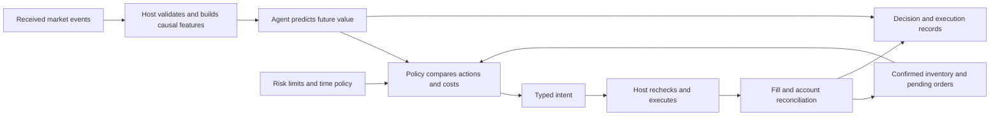

# Research proposal: a learned BTC5m strategy with repeated decisions

> **Scope update — 20 October 2026:** the active plan is now [Task A: terminal-probability ML lab](btc5m_ml_lab_terminal_probability_plan_2026-10-20.md). Start with `research/ml_lab/ai_settlement`, two explanatory data/training notebooks and a reusable inference artifact. Later replace the probability backend inside the existing `settlement_value` strategy, keeping the selected policy unchanged. Short-horizon models and RL are deferred.
>
> **Framework status correction:** retries, managed exits, re-entry/continuous execution, replay SELL feedback and shared capture/recording have since been added. The gap descriptions in sections 1 and 4 and the controller-first sequence in section 8 below are the historical 15 October assessment, not current prerequisites. The linked Task A plan contains the current inspected status and integration path, including the point-probability versus conservative-band contract. The rest of this original proposal is retained as background for the broader research direction.

15 October 2026. Design proposal based on the current working tree, including its uncommitted implementation. No strategy, model, run configuration, or live trading behavior is changed by this note. Proposed names and settings below are not implemented interfaces or validated trading parameters.

## 1. The strategy we are trying to build

At each decision time, use information actually available then to estimate the value of possible future outcomes. Combine that forecast with executable prices, confirmed inventory, costs, remaining time, and risk limits. Decide whether to wait, enter, continue holding, or exit. After a confirmed exit, optionally begin another bounded episode in the same five-minute market.

The learned component can be called the **agent**, but its first responsibility should be forecasting. The full trading agent consists of that predictor, a deterministic decision policy, and the existing execution host. Repeated prediction means inference on new observations; it does not require retraining during the window.

The distinction matters: a useful prediction is not itself an order, and disagreement with an earlier prediction is not automatically a reason to reverse a position.

### What the current strategy and notebook actually do

The current `settlement_value` driver estimates terminal Up probability using an analytical endpoint or TWAP-proxy backend. It evaluates both outcomes against depth, fees and sizing constraints. Its per-window state spends its single attempt when an entry intent is emitted. On confirmed exposure, it requests hold-to-resolution. Although `_observe()` runs before its holding gates, the strategy does not use refreshed estimates to make discretionary exits.

Lesson `12_first_ml_dataset.ipynb` asks a different question: **will the Up midpoint be strictly higher five seconds later?** It uses seven causal features and a regularized logistic model. Unchanged and lower prices share class zero; unavailable future prices remain unlabeled. It does not predict terminal Up, trade profitability, or the size of a future move. Its default one-window split demonstrates pipeline mechanics, not generalization.

Both are useful starting points, but their outputs cannot be interchanged. A 70% chance of a quote rising is not a fair token value of 70 cents.

### Three related hypotheses to keep separate

1. **Learned settlement value:** can a learned probability replace or improve the analytical probability used for entry?
2. **Managed exposure:** can reassessment improve hold-versus-exit decisions after entry?
3. **Repeated trading:** can a bounded sequence of entries and exits improve net window results after paying for every transition?

Success on the first does not establish the second or third. An exit can reduce drawdown while lowering expected profit. More accurate predictions can also produce a worse trading policy if they create excessive turnover.

## 2. What belongs to the model and what stays deterministic

### Model responsibility

Estimate a clearly named future quantity from current and trailing observations. Initially this can be terminal outcome probability; later it can include future executable liquidation value at a small number of horizons. Return availability and the identity of the prediction alongside its value.

If uncertainty estimates are included, name their method and validate their interpretation. `p_up = 0.70` is a probability about an event, not “70% confidence that the model is correct.” An ensemble spread or a sensitivity band is not automatically a calibrated confidence interval.

### Strategy-policy responsibility

Translate predictions into a desired action using costs and current state. This includes:

- Side selection and minimum entry advantage.
- Hold-versus-exit comparisons and separate exit margins.
- Optional persistence requirements and cooldowns to prevent oscillation.
- A bounded number of episodes and attempts, with window turnover and loss budgets.
- Whether size is fixed or risk-constrained, and whether adding to a position is allowed.
- A defined end-of-window policy.

For the first experiment, keep those choices configurable and deterministic. This makes it possible to identify whether a result came from the forecast, policy, or execution assumptions.

### Host responsibility

The existing host remains the sole owner of market identity, feed ingestion, clocks, input readiness, order submission, account reservations, confirmed fills, sellability, cancellation, reconciliation, durable state, protection, and recovery. The predictor cannot override these controls or submit an order directly.

One execution authority is especially important when model output changes while an earlier order is still pending. A new prediction does not cancel a fill or prove that an exit succeeded.

## 3. The general workflow

The loop continues while flat, while exposed, and while waiting for order feedback. **Prediction frequency and trading frequency are separate controls.** Most evaluations can reasonably result in no action.

### Proposed lifecycle

`NOT_READY → FLAT → ENTRY_PENDING → OPEN_UP / OPEN_DOWN → EXIT_PENDING → VERIFIED_FLAT → COOLDOWN → FLAT`

`HALTED`, `RECOVERY_REQUIRED`, and `WINDOW_CLOSED` are additional states. Partial exposure must be represented even if the remainder of an entry is still pending. An exit that partially fills leaves a position; it cannot transition to flat by assumption.

- **Flat:** compare feasible Up and Down entry candidates with waiting.
- **Entry pending:** continue observing; do not duplicate entry. If the thesis changes, cancel the unfilled remainder where possible, then reconcile. Any filled shares enter the exposure-management path.
- **Open:** reevaluate the held instrument. Hold, request exit, or obey a higher-priority protective action.
- **Exit pending:** continue observing, but do not reopen or send conflicting sells. Reconcile fills, remaining shares and reservations.
- **Verified flat:** finish accounting, resolve orders and any residual inventory policy, then consider another episode within the remaining budgets.
- **Near close:** disallow entries that cannot satisfy the configured lifecycle. Apply a tested liquidation deadline, or an explicit settlement fallback for residual exposure.

For v1, allow at most one directional position at a time, no pyramiding, and no simultaneous Up/Down hedge. An intended reversal is two steps: sell the held token, verify flat, then independently assess buying the other token. Buying Down while holding Up creates two positions; it does not liquidate Up.

### Entry and exit ask different economic questions

For a verified binary contract paying one unit per winning net share, let `p_j` be the predicted terminal winning probability of side `j`, and let `C_buy,j(q)` be total acquisition debit for `q` **net payoff-bearing shares**. Fees charged in shares must be reflected in the gross quantity needed to obtain `q`.

The terminal-value entry benchmark is:

`entry_EV_j(q) = q × p_j − C_buy,j(q)`

Buy only if the risk-constrained candidate clears the configured margin. Cost includes executable depth, relevant fees and delay assumptions; do not add the spread twice if the ask prices already include it.

For shares already held, let `L_now,j(q)` be executable net liquidation proceeds. A simple risk-neutral terminal-hold benchmark is:

`hold_advantage_j(q) = q × p_j − L_now,j(q)`

This compares holding to settlement with selling now. It is a useful first policy baseline, **not** the optimal value of holding briefly and retaining the option to sell later. The purchase price is needed for realized PnL and risk limits, but is sunk in this incremental comparison.

Two synthetic examples, assuming one held Up share and ignoring fees solely for explanation:

- Probability declines from 0.70 to 0.62, but the sellable bid is 0.55. The terminal-hold advantage is still +0.07. The weaker forecast alone does not justify selling.
- Probability remains 0.70, but the sellable bid rises to 0.76. Selling can be attractive even though the predicted winner has not changed.

For a trading-horizon forecast, define `V_j,h(q) = E[net liquidation proceeds at t+h | information at t]`. Then compare `V_j,h(q) − C_buy,j(q)` when flat and `V_j,h(q) − L_now,j(q)` when exposed. These use different cost bases and therefore need not give the same action. A future-bid model still needs an explicit assumption about depth, delay and fillability; its predicted value is not a promised fill.

Entry and exit thresholds should differ. The region between them permits holding or waiting instead of repeatedly crossing the spread. Persistence and cooldown settings may help, but emergency exits must bypass them. Values are research choices to select on development data, not defaults justified by this proposal.

### Missing pieces to decide before ML architecture

1. **Primary objective:** net window PnL subject to loss/exposure constraints, with drawdown and turnover reported separately. Specify whether lowering risk is worth sacrificing mean PnL.
2. **Action set:** start with wait, buy Up, buy Down, hold and sell held shares. Defer partial discretionary exits and continuous sizing until basic behavior is reliable.
3. **Terminal policy:** liquidation before close, deliberate settlement hold, or a bounded fallback. A settlement commitment must not coexist with discretionary selling.
4. **Risk budget:** maximum position debit/full-loss exposure, cumulative window loss, turnover, episodes, retries and account-wide reserved capital. Repeated small entries can create large cumulative losses.
5. **Invalid prediction policy:** block new risk; exposed positions follow a defined host-controlled timeout, protection and recovery policy. Missing data must not turn into an inferred opposite signal.
6. **Order races:** a prediction can expire during submission; cancellations may arrive after fills; sells may be incomplete or below minimum size. Verified account state, not requested action, drives the next state.
7. **Reproducibility:** pin model, feature schema, preprocessing, target, policy config, execution scenario, data manifest and code identity. Persist window/episode counters across restart.

## 4. Fit with the current project

### Existing foundations to reuse

- `strategies/protocol.py`: synchronous `evaluate(snapshot, context, features)` returning `StrategyEvaluation`.
- `strategies/registry.py` and `settlement_value/plugin.py`: plugin registration, validated configuration, input contracts, feature declarations and lifecycle selection.
- `facts/` and `indicators/graph.py`: host-owned readiness and reusable incremental features.
- `strategies/context.py`: immutable confirmed quantity, cost, lifecycle, entry/exit permissions and reference facts.
- `core/intents.py` and the existing planner/lifecycle/gateway: typed entries, exits, cancellations and one execution spine.
- `runtime/decision_records.py`, observation and reporting: reusable decision evidence.
- `data_warehouse/`, `research/replay/` and `research/strategy_replay/`: recorded data, causal reconstruction, virtual-time order simulation and the real-driver evaluation loop.

The collector and offline replay infrastructure already exist. This research extends them; it does not call for a separate warehouse or a second execution system.

### Required changes, verified in current source

**A new strategy plugin.** A proposed `learned_value` plugin should preserve `settlement_value` as the benchmark. Its policy must manage exposure instead of inheriting the existing one-attempt/hold commitment. Today `EpisodeState.entry_emitted` permanently spends the attempt for that window, and `plugin.py` permits only `hold_to_resolution`.

**Repeated episode orchestration in the host.** In `trading_runtime.py`, entry eligibility currently requires `lifecycle.state is None`. After terminal entry/exit/cancel handling, the host requests stop; a successful hold commitment also requests stop. There is terminal-state release for rebinding/recovery, but no general demonstrated same-market trading loop. Re-entry needs deliberate completion, account refresh, reservation cleanup, new episode/session identity, protection reset and budget checks. It is not just `exit_on_flat: false` or removing one Boolean.

**Exit feedback in strategy replay.** `ReplayAgent._decide()` translates `EnterIntent` and records `HoldToResolutionIntent`; other intents go to `unsupported_intents`. `_feedback()` updates inventory for BUY fills only. The lower-level `research/replay/engine.py` already has BUY/SELL inventory constraints and order simulation. Extend the adapter for exits, cancellations, delayed feedback, realized costs, partial inventory and multiple episode identities. An experiment emitting an unsupported intent should fail qualification, not silently continue with misleading PnL.

**Exit-capable readiness.** `on_evaluation()` currently returns early when `prepare_aligned_eval()` is not ready. Do not assume a prediction can drive an exit when entry inputs become unavailable. Audit the distinction between model readiness, entry readiness and executable exit readiness; host protection must remain operable without a valid new model output.

**Cost state for repeated trades.** The current host `_position_cost()` totals session BUY cash. That is sufficient for its current episode scope, but repeated entry/exit accounting must distinguish remaining cost basis, cumulative realized PnL and fees. Reusing the old session after selling can make these quantities wrong.

**Versioned local model inference.** Model loading, preprocessing and validation need an explicit integration seam. The existing protocol remains suitable for small local models. If inference later becomes slow, add a bounded worker and explicit prediction snapshots rather than blocking feed ingestion or making network calls inside `evaluate()`.

Some older architecture prose still describes settlement and research replay as unimplemented; the working tree now contains both. The statements above use inspected source behavior, not that older status list.

### Proposed model call contract

Input: immutable feature values/history, market/window identity, as-of time and feature schema. A pure market forecaster initially does not need the private position. The decision policy consumes inventory separately. A future learned action-value policy would also need position, pending orders and remaining budgets as inputs.

Output:

- Model/artifact and feature-schema IDs.
- Market/window and snapshot identity; as-of/completion times and prediction expiry.
- Target name and horizon, with units.
- `READY`, `NOT_READY` or `OUT_OF_SCOPE`, with a reason.
- Prediction values and, where justified, named uncertainty estimates.

Reject wrong-market, wrong-schema, nonfinite, expired or out-of-range outputs. Pin one artifact for a window and load it before entry eligibility. A model result computed for a previous window must never be accepted because its numerical values look plausible.

Keep prices, quantities and monetary accounting in the project's exact arithmetic. Numerical feature arrays and model probabilities can use floats at an explicit boundary.

### Cadence and technical feasibility

The current settlement input contract declares Binance/book triggers with one-second coalescing and a one-second timer. Scheduler overrides and the runtime loop also affect actual cadence. **One-second reassessment is a reasonable first experiment, not a measured performance claim.** Triggered risk checks can operate separately from forecast cadence.

A small local model is technically compatible with this Python strategy boundary. Benchmark the complete receive → feature → inference → intent → dispatch → fill-feedback path, including tail latency and stale-result rejection. A very fast predictor does not eliminate venue or account delays. Current [Polymarket order-lifecycle documentation](https://docs.polymarket.com/concepts/order-lifecycle) describes a 250 ms taker hold on selected markets and a period in which the pending order cannot be canceled. Inspect metadata for the actual market; do not assume that every BTC5m window has the same delay.

Current [fee documentation](https://docs.polymarket.com/trading/fees) distinguishes taker fees and market parameters. Historical research must retain historically evidenced schedules or explicit scenario assumptions rather than applying today's documentation retroactively.

## 5. Defining the learning tasks and datasets

Do not train a generic label called “edge.” An edge is a conditional expected value relative to an action, a price, a size, costs and a horizon. Start with a measurable future target and calculate the actionable edge around it.

### Task A: terminal outcome probability

Target `Y = 1` if official Up wins, else zero, with explicit handling of any nonbinary/invalid outcome. Learn `P(Y=1 | X_t)`; Down probability is its complement only under that verified binary payoff. Combine predictions with current executable costs outside the model.

This is the clearest first replacement for the analytical settlement forecast. Every time row in the same market shares a terminal label; 300 rows do not represent 300 independent outcomes. Weight windows deliberately and assess uncertainty in market/session/calendar blocks.

Use qualified outcome labels for actual-contract claims. Current replay labels are explicitly `proxy_outcome`: one nonzero recorded payout entry identifies a candidate winner while payout units remain unknown. Keep provisional K, reference-stream identity and rule assumptions visible. Proxy-labelled experiments can test machinery and hypotheses; they cannot certify settlement prediction for the live contract.

### Task B: short-horizon executable value

For a fixed side, size and declared execution scenario, target future bid-side liquidation value or its change over a predefined horizon. A small predefined set such as 5/15/30 seconds is an experiment suggestion, not a selected optimum. Include the size/depth condition when values depend on size.

This is closer to proactive exits and the inspiration from notebook 12. Predict magnitude or a distribution, not only the chance that a midpoint rises. Up and Down future executable bids are not complements: both books have their own spreads, depth and liquidity.

Declare what happens when `t+h` reaches the window end: censor the row, or explicitly switch to the verified terminal target with a horizon indicator. Do not silently mix terminal payouts with ordinary quote changes.

### Task C: value of actions or a learned policy

Target the value of wait/buy/hold/sell under an explicit continuation policy, or learn a policy in an environment. This needs inventory, costs, time and pending execution state, not just a market snapshot. Historical paths do not reveal every counterfactual fill. A simulated label is conditional on the simulator and its small-order/no-market-impact approximation.

Do not label an entry by the best future exit or hindsight winner and call it a causal live action. A fixed, declared exit policy is labelable under replay assumptions. Path-dependent barrier targets can be explored later, but their touch order and executability must be defined.

### Data preparation contract

1. Freeze many complete market windows across multiple sessions/days and conditions. Preserve rule/reference versions, both books, received times, source times, connection generations and clock observations. Collect the fields actually required by the proposed input contract.
2. Reconstruct only what was knowable at each decision time. Warm up features causally and respect gaps, resets and freshness. Retrospective quality annotations can audit/filter datasets, but cannot masquerade as real-time features.
3. Materialize separate feature rows and label rows linked by market, time, side and horizon. Record label availability time and eligibility reason. Unavailable labels stay missing.
4. Build features through shared causal definitions usable in replay and live inference. Begin with the notebook's seven features; add reference distance, analytical probability, both-book state or flow only as named hypotheses. Normalization, clipping, calibration and selection are fitted on training data only.
5. Split by later whole markets and preferably calendar/session blocks. Purge overlapping feature/label intervals and ensure every training label was available by the simulated training cutoff. Do not shuffle per-second rows. Reserve a calibration/validation block separately from the final test.
6. Log every model, feature and policy trial. A holdout repeatedly inspected during development is development data; obtain a fresh later test for the final claim.

The checked-in working data's frozen S2 split file currently lists **45 development and 18 holdout markets**. This is a statement about that saved file, not a fresh full inventory or a claim of statistical sufficiency. Lesson 12's default still uses one teaching window. The existing limited capture is suitable for pipeline development; more diverse calendar coverage is needed before choosing a production model.

Chronological evaluation follows [scikit-learn's time-series guidance](https://scikit-learn.org/stable/modules/cross_validation.html#time-series-split); this project's grouped markets and overlapping horizons require additional controls beyond a default splitter.

## 6. Model and architecture progression

### Start with a simple supervised model

Run a training-prior baseline, the analytical settlement model and a book-based diagnostic alongside regularized logistic regression. For terminal labels, book midpoint is an informative market baseline but includes microstructure distortions; for next-quote-rise labels it is not a probability baseline.

Then try one fixed-budget gradient-boosted tree challenger. It can represent nonlinear interactions between remaining time, reference distance, volatility and book state without designing a deep sequence network. A residual correction to the analytical model is also a sensible candidate, but it must compete against learning from scratch under the same held-out protocol.

Select the model on the target it actually predicts. For terminal probabilities use log loss, Brier score and reliability bins with counts, plus time-to-close and regime slices. These scores do not measure profit, and a lower Brier score alone does not establish better calibration. Fit any calibrator on later out-of-training predictions. See [probability calibration guidance](https://scikit-learn.org/stable/modules/calibration.html).

For future liquidation values, evaluate magnitude/tail errors and economic ranking, then evaluate the entire policy in replay. A small mean error can hide large errors precisely where the strategy trades.

### Add temporal deep learning when there is evidence to justify it

Candidate order: small temporal convolution or recurrent network, then a book-structure encoder, then a transformer if scale and ablations justify it. Sequence features can capture evolving flow and cross-feed responses. They also increase data requirements, sensitivity to sampling/masking, latency and reproducibility work.

[DeepLOB](https://arxiv.org/abs/1808.03668) provides a primary example of convolutional book structure combined with temporal learning. Its equity results do not establish applicability to short-lived binary BTC contracts; that transfer is a hypothesis for this project.

Use the same targets, chronological data and policy as the simpler models when measuring the added value of a sequence architecture.

### Reinforcement learning as the later game formulation

One episode can be a five-minute market; account bankroll and risk limits carry between episodes if the intended evaluation spans many windows. Observations include causal market history, confirmed holdings, pending orders, cash/reservations, remaining time and budgets. Actions initially match the small discrete action set.

Define reward so it accounts for trading costs and terminal/residual exposure exactly once. For example, changes in conservatively marked portfolio equity plus terminal payout reconciliation can telescope to economic PnL, with an explicitly named additional risk objective. Do not reward unrealized gains at the ask or remove losing residuals when the episode ends. Time steps should reflect elapsed time if decisions are event-driven.

Delay, partial fills, rejected orders, cancellations, sellability, feed failures and settlement behavior belong in the environment. Historical replay assumes our small trades do not change future market events; it does not supply a full interactive exchange. The learner can exploit simulator weaknesses even while improving simulated reward. Offline RL additionally faces limited coverage of counterfactual actions.

[Nagy, Calliess and Zohren](https://arxiv.org/abs/2301.08688) study an execution agent consuming a directional signal in a simulated order-book environment. This supports separating prediction from execution policy as a research design, not a claim that RL will beat this project's deterministic controller.

RL becomes worth attempting after a supervised signal, a repeated-trade baseline and a defensible environment exist. Consider action-value learning or limited policy learning before an unrestricted end-to-end agent.

## 7. Experiments that answer the actual questions

Freeze a comparable budget, execution scenario and later evaluation block. Separate forecast replacement from management changes:

1. Analytical forecast + existing hold policy: current benchmark.
2. Learned terminal forecast + the same hold policy: isolates prediction replacement.
3. Analytical forecast + managed exits: measures the value of dynamic management alone.
4. Learned forecast + the same managed policy: measures the combination.

For the management comparisons use the same declared terminal-value hold/exit benchmark first. Introduce a short-horizon model as a subsequent experiment, because it changes the meaning of the forecast. Add re-entry only after one entry/exit episode is correct, and compare it with an identical no-re-entry variant.

Report both forecast quality and full policy results: total and per-window net PnL, realized versus residual inventory value, drawdown, tail losses, costs, turnover, skipped windows, episode counts, fill/exit rates, exposure time and unsupported/rejected actions. Include all windows, not just trades or winners. Use block-based uncertainty estimates and cost/delay/depth stress scenarios. A favorable replay assumption is not a profitability bound.

Repeatability, causal input construction, exact fee/inventory accounting and safe recovery are prerequisites. They are different gates from evidence of a profitable forecast. Shadow observation can check feature parity, cadence and decisions; it cannot observe our counterfactual fills or validate strategy PnL.

## 8. Recommended development path

**First, specify the controller and model contract.** Agree on the small action set, one-position rule, entry/exit comparisons, episode limits, invalid-prediction behavior and terminal policy. Proposed initial scope: local frozen inference, existing one-second trigger scale, bounded taker orders and deterministic size/risk constraints. Treat all threshold values as development choices.

**Second, make one entry/exit episode replay correctly using a deterministic test predictor.** Extend the existing adapter and use meaningful lifecycle checks for pending entry, partial fill, cancel/fill race, stale output, SELL feedback, residual dust, restart and expiry. Then add bounded same-window re-entry and its accounting. This isolates mechanics from ML performance.

**Third, build a multi-window supervised dataset and simple terminal model.** Reuse lesson 12's causal preparation and train-only preprocessing patterns with the correct target. Preserve proxy-label status while qualifying settlement evidence. Run the forecast/policy comparison above without changing all components together.

**Fourth, add a short-horizon executable-value forecast if dynamic exits are the priority.** Test whether it improves on terminal-value management after costs and delay. Only then consider richer sequences.

**Fifth, run read-only shadow inference on newly recorded windows.** Check live/replay feature parity, availability, tail latency and disagreement reasons. Integrate repeated execution episodes into the production host only after the replay controller and accounting are proven. Any funded trial is a separate, explicit decision after current contract metadata and lifecycle requirements are verified.

**Later, consider RL** against the established supervised-plus-deterministic baseline, with a separate environment qualification effort.

The recommended first milestone is therefore a **model-independent repeated-decision controller in replay**, followed by a **simple learned probability model**. This delivers a structure in which changing the predictor does not require redesigning execution, and lets the research determine whether forecasting, management, or repeated trading actually adds value.

## Inspected project evidence

- [Lesson 12](../../src/tyrex_pm/research/tuto_btc5m/12_first_ml_dataset.ipynb) and [causal ML helpers](../../src/tyrex_pm/research/tuto_btc5m/advanced.py).
- [Settlement driver](../../src/tyrex_pm/strategies/settlement_value/driver.py), [plugin](../../src/tyrex_pm/strategies/settlement_value/plugin.py), [episode state](../../src/tyrex_pm/strategies/settlement_value/state.py) and [economics](../../src/tyrex_pm/strategies/settlement_value/economics.py).
- [Strategy protocol](../../src/tyrex_pm/strategies/protocol.py), [context](../../src/tyrex_pm/strategies/context.py) and [live runtime](../../src/tyrex_pm/runtime/trading_runtime.py).
- [Strategy replay adapter](../../src/tyrex_pm/research/strategy_replay/run.py), [execution engine](../../src/tyrex_pm/research/replay/engine.py) and [outcome-label handling](../../src/tyrex_pm/research/strategy_replay/labels.py).
- [Research lab guide](../../src/tyrex_pm/research/strategy_lab/README.md) and [data interpretation](../implementation/strategies/s0_data_interpretation.md).

External sources linked in the relevant sections were consulted on 15 October 2026. Recommendations are research design judgments; no new training, backtest, timing benchmark or funded execution was performed for this proposal.
